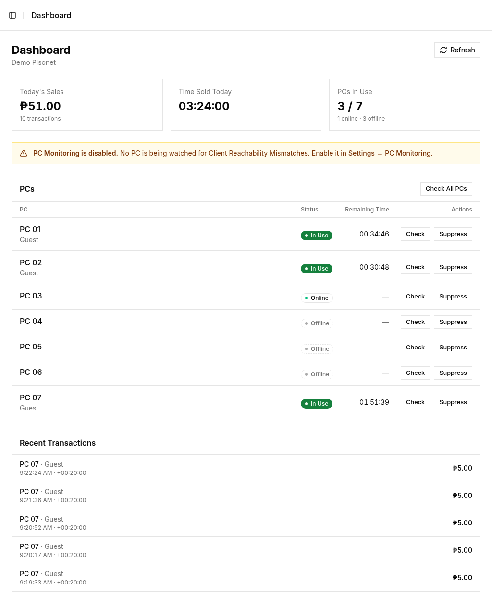

# OpenPiso

OpenPiso runs a Pisonet shop: customers drop coins in a coin slot and get time
on a rental PC. Everything runs on your shop's own network, on Windows
computers you already have. You do not need internet to run the shop.

## What you need

- One Windows computer as the **Server PC**, with a COM header on the motherboard.
- An Allan or generic multi-coin slot, powered from the Server PC.
- Your rental PCs, running Windows.
- A router or switch that connects them all.
- A phone or computer to open the **Web Admin**.

Full list: [What you need](https://h3atman.github.io/openpiso/what-you-need).

## Quick start

1. **Download both installers** from the
   [latest release page](https://github.com/H3atman/openpiso/releases/latest).
   The file whose name contains **Central Terminal** goes on the Server PC. The
   file whose name contains **Client** goes on every rental PC.
   [Download guide](https://h3atman.github.io/openpiso/download)
2. **Install the Central Terminal on the Server PC**, open the Web Admin from
   your phone, and create your Web Admin PIN.
   [Install the Central Terminal](https://h3atman.github.io/openpiso/install-central-terminal)
3. **Wire and test the coin slot.**
   [Wire the coin slot](https://h3atman.github.io/openpiso/coin-slot-wiring) ·
   [Connect and test it](https://h3atman.github.io/openpiso/coin-slot-settings)
4. **Install the Client on each PC** and approve it in the Web Admin.
   [Install the Client](https://h3atman.github.io/openpiso/install-client)
5. **Set your Shop Rate** and Shop Hours.
   [Shop Rate and Shop Hours](https://h3atman.github.io/openpiso/shop-rate-and-hours)

## Full guide

Read the [OpenPiso setup guide](https://h3atman.github.io/openpiso/).

## Developing

See [Development](docs/development.md).

## Documentation

[Installation](docs/installation.md) · [Development](docs/development.md) ·
[Architecture](docs/architecture.md) · [API](docs/api.md) ·
[Database](docs/database.md) · [Hardware](docs/hardware.md) ·
[Glossary](docs/glossary.md) · [Decisions](docs/adr/README.md)

[Contributing](CONTRIBUTING.md) · [Security reporting](SECURITY.md)

## License

[PolyForm Shield 1.0.0](LICENSE): source-available, **not OSI open source**.
Free to use, including running a shop, and to inspect/adapt for permitted purposes.
No providing competing products, including selling/reselling it as a competing
substitute. The full license controls, including its exceptions.
See [third-party notices](THIRD-PARTY-NOTICES.md).
